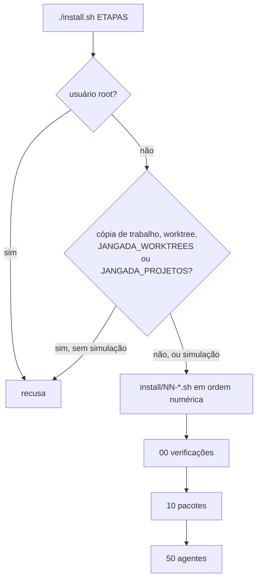
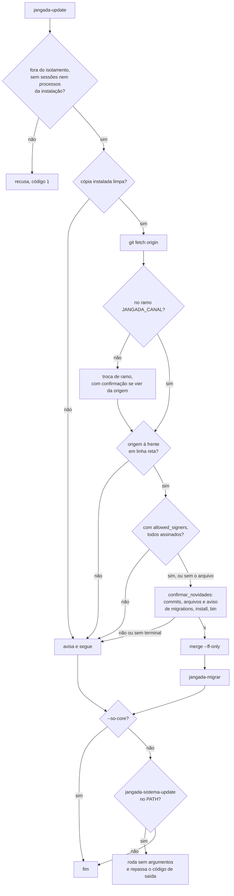
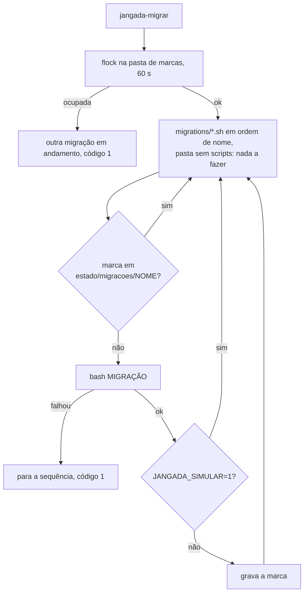

# Atualização e migrações

O Core roda de uma cópia instalada em `~/.local/share/jangada-core`
(`JANGADA_CORE_PATH`), que só avança pelo `jangada-update` e só depois de você ver
e aceitar os commits novos. Mudança que exige ajuste numa instalação
existente chega por uma migração do Core, aplicada uma única vez pelo
`jangada-migrar`. O sistema (pacotes, snapshots, recarga da sessão) é do
`jangada-sistema-update`, do jangada-shell, que o `jangada-update` chama no
fim quando ele está no PATH.

## Instalação inicial



- Com argumentos, roda só as etapas com esse prefixo: `./install.sh 10 50`.
- `JANGADA_SIMULAR=1 ./install.sh` mostra o que seria feito sem executar.
- A pasta de onde o `install.sh` roda vira o `JANGADA_CORE_PATH`. A cópia de
  trabalho, os worktrees e tudo em `JANGADA_PROJETOS` são graváveis de dentro
  do isolamento, então instalar dali faria os hooks e a sessão rodarem o que o
  agente muda. Nelas só a simulação roda.

## Como escrever uma etapa ou migração

As duas usam as funções de `install/lib.sh`:

| Função | Uso |
|---|---|
| `executar CMD...` | roda o comando, ou só o mostra com `JANGADA_SIMULAR=1` |
| `como_root CMD...` | o mesmo, com `sudo` quando não é root |
| `copia_seguranca ARQ` | cópia `.jangada-DATA.bak` antes de alterar um arquivo existente |
| `copiar_se_ausente ORIGEM DESTINO` | cria o arquivo do usuário só se ele não existir |
| `simulando` | verdadeiro com `JANGADA_SIMULAR=1` |

Regras de uma migração (`migrations/README.md`):

1. Nome `AAAAMMDDHHMM-descricao.sh`; a ordem de aplicação é a do nome.
2. Pode rodar de novo sem estragar nada: uma falha no meio faz ela ser
   tentada outra vez.
3. Nunca apaga arquivo do usuário; move para `.bak` com data.
4. Explica no topo o que mudou e por quê.
5. O padrão correspondente é corrigido também, para a instalação nova.

## jangada-update



- **Confirmação.** A origem da cópia instalada é a cópia de trabalho, cujas
  refs um agente isolado pode gravar. Por isso nada que chega por ela roda
  sem você ver: `confirmar_novidades` mostra os commits, os arquivos e um
  aviso quando mudam `migrations/`, `install/` ou `bin/`. Os textos passam
  por um filtro de caracteres de controle, para que uma sequência de escape
  não disfarce a lista. Sem terminal, a resposta é não.
- **Assinaturas.** Com `~/.config/jangada/allowed_signers`, todo commit que
  chegaria precisa de assinatura válida por esse arquivo, conferida commit a
  commit (o `--verify-signatures` do merge só olharia o último); se algum
  não tem, nada é aplicado. O arquivo fica fora da cópia de trabalho e
  somente leitura no isolamento, então um agente não inclui nele uma chave
  própria. Os agentes fazem commit sem a chave, que o isolamento oculta: o
  `jangada-assinar`, num terminal comum, mostra os commits ainda não
  enviados e sem assinatura válida e os assina com `JANGADA_ASSINATURA_CHAVE`
  depois da confirmação, a partir do primeiro sem assinatura, para não
  reescrever o que a cópia instalada já aplicou. Commit enviado sem
  assinatura e ainda não aplicado fica fora do que ele reescreve e dentro do
  que o `jangada-update` confere: o `jangada-assinar` avisa e mostra o
  comando que avança a cópia instalada à mão, depois de você conferir esses
  commits. Os merges do `jangada-agente-fim --integrar` são refeitos e
  assinados junto, e o próprio `--integrar` chama o `jangada-assinar` depois
  de apagar o ramo, quando a raiz é a cópia de trabalho do jangada; chamado
  de dentro da própria sessão, ele só avisa, porque a limpeza segue sem
  terminal. Refazer um merge perde o que foi resolvido ou alterado nele à
  mão: com conflito, o rebase para e `git rebase --abort` desfaz; sem
  conflito, o comando nota a diferença, volta o ramo ao que era e não assina
  nada. O `jangada-update` e o `jangada-assinar` fixam o `gpg.ssh.program`
  em `ssh-keygen`, porque o da configuração do repositório rodaria fora do
  isolamento.
- **Avanço rápido.** Só `--ff-only`: origem que não avança em linha reta
  não é aplicada.
- **Canal.** `JANGADA_CANAL` (`main` ou `estavel`) escolhe o ramo que a cópia
  instalada acompanha.
- **Guardas.** O comando recusa rodar dentro do isolamento, com sessões de
  agentes abertas no tmux do Jangada ou com processos que usam a instalação.
  Interrompa os executores e preserve os registros antes de atualizar. Não há
  simulação: `JANGADA_SIMULAR=1` é recusado, e as migrações se conferem com
  `JANGADA_SIMULAR=1 jangada-migrar`.
- **Git sem ganchos.** Todo git sobre a cópia instalada passa por
  `jangada_git_seguro`, sem fsmonitor nem ganchos da configuração do
  repositório.
- **Sistema.** Sem `--so-core`, e se `jangada-sistema-update` existir no
  PATH, ele roda no fim, sem argumentos, e o código de saída dele é o do
  comando. Pacotes, AUR, Hyprland, snapshots, initramfs, NVIDIA, recarga da
  sessão e ganchos `pos-update` ficam com o Shell. Código recusado não
  impede o sistema, mas o comando termina com erro.

## Atualização interrompida

O `jangada-update` grava em duas etapas: o avanço da cópia instalada
(`merge --ff-only`) e as migrações. Rodar o comando de novo resolve as
interrupções que não deixam arquivo alterado fora de commit:

| Onde parou | Como fica | O que fazer |
|---|---|---|
| antes do avanço (busca, confirmação) | cópia instalada no commit antigo | rodar `jangada-update` de novo |
| depois do avanço, antes ou durante as migrações | código novo; migração sem marca em `$JANGADA_ESTADO/migracoes/` | rodar `jangada-update` de novo: ele diz "jangada já atualizado" e roda o `jangada-migrar`, que aplica só as que não têm marca |
| migração que falhou | código novo; a que falhou e as seguintes sem marca | corrigir a causa mostrada e rodar `jangada-migrar` (ou `jangada-update`) de novo |
| no meio da troca de arquivos | cópia instalada com arquivo alterado fora de commit | ver abaixo |
| no `jangada-sistema-update` | código já atualizado | é do jangada-shell; rodar `jangada-update` de novo repete só a parte do sistema |

A trava do `jangada-migrar` é um `flock`, que o sistema solta quando o
processo morre; não há arquivo de trava para apagar. Uma migração
interrompida no meio roda de novo por inteiro, e por isso precisa poder
rodar de novo sem estragar nada (regra 2 das migrações).

Se a troca de arquivos parou no meio, o `jangada-update` recusa a cópia
suja, lista os arquivos e não mexe neles. Confira antes de desfazer:

```sh
git -C ~/.local/share/jangada-core status
git -C ~/.local/share/jangada-core diff
```

Se a lista mostra só arquivos do próprio Core e nenhuma alteração sua, volte
a cópia ao commit em que ela está e rode a atualização de novo:

```sh
git -C ~/.local/share/jangada-core reset --hard HEAD
```

Um `index.lock` deixado pelo git interrompido não aparece no `status`: o
avanço (ou o `reset`) para com "não foi possível atualizar o repositório" e
a mensagem do git de que o `index.lock` já existe. Apague-o (`~/.local/share/jangada-core/.git/index.lock`) só
depois de conferir que nenhum git está rodando sobre a cópia. Alteração sua
na cópia instalada sai antes por um `git diff` salvo em outro lugar, já que
o `reset --hard` a descarta. O `testes/update.sh` reproduz os três primeiros
casos e o da cópia suja.

## Voltar à versão anterior

Desfazer commits na cópia instalada só é seguro quando o estado gravado pela
versão nova é aceito pela antiga. Confira as migrações entre as duas
versões (`git -C ~/.local/share/jangada-core log --oneline ANTIGA..HEAD --
migrations/`) e o que cada uma diz no topo, antes de voltar. Migração que
converte dados não se desfaz voltando o código: a versão antiga leria o
formato novo. Nesse caso, a volta precisa de um passo próprio, descrito na
própria migração.

As migrações de 30/10/2026 só avisam, e o banco das tarefas
(`tarefas.sqlite`) não mudou de formato. O que muda são lugares e nomes que
a versão antiga não conhece:

| Gravado pela versão nova | Na versão anterior a ela | Antes de voltar |
|---|---|---|
| sessões em clone (Git separado) | o `jangada-agente-fim` antigo recusa: "não é worktree registrado" | encerrar todas com o `jangada-agente-fim` da versão nova |
| `$JANGADA_ESTADO/provedores/` e `$JANGADA_ESTADO/codex/` (conversas e memória por sessão) | o `$JANGADA_ESTADO` inteiro fica legível dentro do isolamento, e essas pastas não estão ocultas: todo agente leria as conversas de todas as sessões | mover as duas pastas para fora do `$JANGADA_ESTADO` e fora do que o isolamento mostra; elas não são apagadas |
| pastas `delegacao-<pid>-*` e temporários `execucao-<dono>-*` | nomes diferentes, que a versão antiga não apaga | nada; ficam para conferência |
| marcas das migrações novas | sem efeito | nada; ao voltar à versão nova, elas não repetem o aviso |

Os passos, com nenhuma sessão nem executor aberto:

```sh
git -C ~/.local/share/jangada-core status
```

```sh
mkdir -m 700 ~/jangada-preservado-AAAAMMDD
mv ~/.local/state/jangada/provedores ~/.local/state/jangada/codex ~/jangada-preservado-AAAAMMDD/
```

```sh
git -C ~/.local/share/jangada-core reset --hard COMMIT_ANTERIOR
```

Com `JANGADA_ISOLAR_CASA=inteira`, a pasta pessoal toda fica legível no
isolamento, inclusive a pasta preservada; nesse modo, guarde-a num disco ou
lugar fora da pasta pessoal. Na versão anterior, as conversas abertas
depois da atualização não aparecem, porque o cliente volta a usar a pasta
de sempre (`~/.claude`, `~/.gemini`). Para voltar à versão nova, rode o
`jangada-update` (ele oferece de novo os commits, com confirmação) e, antes
de abrir sessão, devolva as duas pastas ao `$JANGADA_ESTADO`.

## jangada-migrar



Em simulação a marca não é gravada: gravar faria a execução seguinte, a de
verdade, pular uma migração que nunca foi aplicada.

A pasta `migrations/` começa vazia no Core. As migrações anteriores à
separação ficam no histórico do monorepo, e as marcas delas em
`$JANGADA_ESTADO/migracoes/` impedem que sejam reaplicadas.

### Padrões do isolamento de 30/10/2026

A migração `202610301200-avisar-isolamento-credenciais.sh` não grava nada:
ela mostra, uma vez, o que muda na configuração de quem atualiza. Os novos
padrões do `jangada-isolar` valem para quem não definiu as variáveis no
`jangada.conf`:

| Antes | Agora | Para voltar ao modo antigo |
|---|---|---|
| pasta pessoal inteira legível | casa mínima | `JANGADA_ISOLAR_CASA=inteira` |
| ambiente herdado, menos a lista fixa | lista base, sem nomes de credencial | `JANGADA_ISOLAR_AMBIENTE=herdado` |
| keyring inteiro sem `JANGADA_ISOLAR_KEYRING_ITEM` | keyring fechado | `JANGADA_ISOLAR_KEYRING=servico` |
| login dos três provedores no perfil `agente` | só o do principal e o do destino da delegação | `JANGADA_ISOLAR_PROVEDORES=claude:codex:agy` |

O modo antigo avisa no terminal a cada abertura. Valor fora da lista é
recusado, em vez de cair calado num modo sem proteção. O ajuste fino, sem
voltar ao modo antigo, é `JANGADA_ISOLAR_CASA_LER` para caminhos e
`JANGADA_ISOLAR_AMBIENTE_MANTER` para variáveis. Uma sessão aberta antes da
atualização segue com o modo antigo até ser reaberta. Detalhes em
[isolamento](isolamento.md).

## Testes

| Arquivo | O que cobre |
|---|---|
| `testes/update.sh` | resposta `n` e sem terminal não aplicam; `s` avança, roda a migração e grava a marca; atualização interrompida (avanço sem migração, migração que falhou, cópia suja) retomada sem reaplicar; filtro de caracteres de controle; origem reescrita recusada; com `allowed_signers`, commit sem assinatura ou com chave de fora não é aplicado; `gpg.ssh.program`, fsmonitor e ganchos da cópia instalada não rodam; canal `estavel`; `jangada-migrar` com a pasta vazia, em simulação e com falha; `--so-core` não chama o `jangada-sistema-update`, e sem ele o comando é chamado e o código de saída repassado |
| `testes/update-codigo.py` | em clones descartáveis e com bubblewrap: recusa com árvore suja, sessão ativa, processo da instalação, isolamento e simulação, sem chamar pacote nem migração |
| `testes/consumo.sh` | `jangada-consumo` com registros sintéticos e a dica da barra |
| `testes/hooks.sh` | `mesclar_hooks_claude` e `mesclar_hooks_agy` com o arquivo vazio gravam os hooks (o vazio conta como `{}`); com JSON inválido, avisam e não gravam; o `jangada-verificar` aponta o arquivo vazio ou inválido |
|| `.github/workflows/verificar.yml` | a CI simula a instalação como usuário sem sudo e confere que nada foi escrito |

Veja também as [boas práticas](boas-praticas.md) e o ciclo de versão no
README (`jangada-versao`).

### Git separado de 30/10/2026

Sessão nova do `jangada-agente` deixou de ser `git worktree` e passou a ser
um clone com `.git` próprio em `JANGADA_WORKTREES`. Refs, índice e objetos
novos ficam no clone; os objetos da raiz entram pelo
`objects/info/alternates`, sem cópia. O ramo `agente/NOME` é criado também na
raiz ao abrir, e o `jangada-agente-fim` leva os commits do clone para ele por
`fetch` com conferência de cada objeto, antes de apagar o clone. Na
integração, a entrega passa pelo espelho em `revisoes/espelhos` e só avança a
base pelo commit exato aprovado.

A migração `202610301300-avisar-git-separado.sh` não grava nada: lista as
sessões antigas. Elas não são convertidas. Uma sessão aberta antes da
atualização segue em worktree, com aviso ao ser reaberta, até o
`jangada-agente-fim`, que a encerra pelo caminho antigo. Enquanto houver
sessão antiga, os objetos e as refs `agente/` da raiz continuam graváveis de
dentro dela; a proteção nova vale inteira quando a última for encerrada.

O clone depende dos objetos da raiz. Um `git gc --prune=now` na raiz depois
de reescrever a história dela (por exemplo, `reset` para trás seguido de
`gc`) pode apagar um objeto que o clone ainda usa. Não há outra alternativa
silenciosa: sem `jangada.raiz` no config, uma pasta com `.git` próprio não é
aceita como sessão pelo `jangada-agente-fim`.

### Dados por sessão dos provedores de 30/10/2026

Conversas, histórico, memória e dados de execução do Claude e do agy
passaram a ficar numa pasta de cada sessão, em `$JANGADA_ESTADO/provedores`
(detalhes em [isolamento](isolamento.md), seção "Dados por sessão dos
provedores"). Uma sessão não lê nem altera a conversa de outra, e reabrir a
mesma sessão retoma a dela.

A transição é explícita e restrita: uma sessão registrada antes da
atualização recebe, na primeira abertura, a cópia só da própria conversa
(do Claude, a pasta de `projects` da pasta da sessão; do agy, os arquivos do
id em `.conversa`). O histórico global não é copiado, e as conversas antigas
ficam onde estão, fora do alcance dos agentes. O `settings.json` do agy
entra por cópia a cada abertura: o que o agy muda nele dentro da sessão não
volta à conta.

A migração `202610301400-avisar-dados-provedores.sh` não grava nada. Ela
avisa da troca e de uma variável de caminho do agy definida, que passa a
fazer o isolamento recusar o agy.
