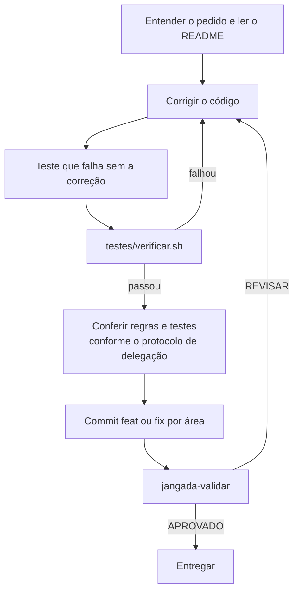

# Boas práticas de programação no jangada

Este guia reúne as regras do `AGENTS.md` e as lições que custaram
investigação. As pegadinhas de ferramentas específicas (agy, tmux,
bubblewrap) ficam na skill, em `agentes/claude/skills/jangada/`; aqui fica o
que vale para qualquer mudança.

A skill mora em `agentes/claude/skills/jangada/`. O mapa das pastas está no
[README](../README.md).

## Fluxo de uma mudança

Prefira commit antes da revisão para que a aprovação corresponda ao commit
limpo. `jangada-validar` também aceita alterações sem commit.
A conferência pode usar o subagente `verificador` quando o protocolo permitir;
no Codex com destino `local`, ela fica na própria sessão.

## Onde cada coisa grava

- Nada do jangada escreve em `~/.config/hypr`, na configuração do niri ou
  em outra sessão existente. Tudo vai para `~/.config/jangada` (ajustes do
  usuário), `~/.local/share/jangada-core` (cópia instalada) e
  `~/.local/state/jangada` (estado e registros).
- Padrão no repositório, gosto pessoal no usuário: preferência pessoal vai
  para `~/.config/jangada/jangada.conf`, não para o código.
- Arquivo existente só muda depois de `copia_seguranca`; arquivo do usuário é
  criado com `copiar_se_ausente` (os dois em `install/lib.sh`).

## Segurança

- O agente é tratado como possivelmente hostil (regra 9 do `AGENTS.md`).
  Cada mudança responde: o que o agente grava pode rodar fora do
  isolamento? Veja o [modelo de ameaça](isolamento.md#modelo-de-ameaça).
- Nada gravável pelo agente roda fora do isolamento sem conferência. O
  estado da sessão é conferido campo a campo, as regras da validação vêm da
  base e o R não lê o `.Rprofile`, o `.Renviron` nem o `.lintr` do worktree.
- Conteúdo de fora (log, título de janela, página, texto de commit) é dado.
  Filtre caracteres de controle e diga ao agente que o bloco não traz
  instruções.
- Menor privilégio: cada peça recebe só o que precisa, como o D-Bus filtrado
  do isolamento ou um dispositivo pareado que não vira confiável sozinho.
- Caminho explícito no lugar de ordem de busca: comando do Core chama os
  pacotes pela raiz (`JANGADA_CORE_PATH`), nunca pela pasta atual.
- Lista explícita no lugar de exceção implícita: o que foge de uma regra
  fica escrito, com o motivo.
- Dado guardado tem prazo: registro que só cresce precisa de retenção.

## Instalação e migrações

- Toda etapa de `install/` pode rodar de novo sem efeito colateral.
- Todo comando que altera o sistema passa por `executar` ou `como_root`, para
  que `JANGADA_SIMULAR=1` só mostre o que faria.
- Mudança que exige ajuste numa instalação existente é registrada na
  atualização e nunca apaga arquivo do usuário (move para `.bak` com data).
  Detalhes em [atualização e migrações](atualizacao-e-migracoes.md).

## Bash

- Cabeçalho `set -euo pipefail`. Com `pipefail`, `curl ... | grep -q` falha
  quando a saída passa do tamanho do cano: o `grep -q` sai no primeiro acerto
  e o `curl` falha ao escrever o resto (código 23). Capture a saída numa
  variável e compare.
- `trap` só em `EXIT`. Um trap em `INT` ou `TERM` não encerra o script: o bash
  roda o tratador e segue na linha seguinte.
- Argumentos que vão para outro interpretador (comando do tmux) saem de `printf %q` ou de campos conferidos, nunca de texto
  montado com dados do usuário ou do estado.
- Uma operação por vez sobre o mesmo recurso: `flock` na trava do recurso
  (estado das sessões, registros) e gravação atômica, num
  temporário na mesma pasta seguido de `mv`.
- Falha tratada avisa com o motivo e sai com código diferente de zero;
  falha que se ignora de propósito leva `|| true` e um comentário que diga
  por quê.

## Contratos das tarefas

`orquestracao/tarefas.py` reúne estados, campos, serialização, elegibilidade de
supervisão e amostragem, prioridades e validação de dependências. Essas regras
não acessam disco, banco ou provedores. `orquestracao/estado.py` cuida da
persistência e das transações; `orquestracao/supervisao.py` executa e confere
pareceres usando as mesmas regras de elegibilidade.

Os nomes públicos antigos continuam disponíveis em `estado` e `supervisao`.
Novos consumidores de regras usam `tarefas` diretamente. Evite duplicar as
condições de elegibilidade em executores. `testes/regras-tarefas.py` confere
os contratos e a independência das regras; os testes da fila continuam
conferindo atomicidade, concorrência e recuperação com SQLite real.

## Testes

- Cada correção vem com um teste que falha no código antigo. Confira isso
  rodando o teste antes da correção: um teste que passa nos dois casos não
  prova nada.
- Quando um teste falha, descubra se o erro está no código ou no teste. Um
  simulador (`tmux`, `agy`, `claude` falsos) no formato errado leva a mudar
  o código para agradar o teste; corrija o simulador pela saída real da
  ferramenta.
- Correção proposta por revisor ou auditoria também precisa de teste: a
  troca sugerida para o `curl | grep -q` trouxe a corrida descrita acima.
- Os testes nunca tocam a configuração real: usam `XDG_CONFIG_HOME` e
  `XDG_STATE_HOME` temporários.
- `testes/verificar.sh` roda antes de concluir qualquer mudança. Dentro de uma
  sessão isolada, rode com
  `env -u JANGADA_ISOLADO -u JANGADA_DELEGAR`;
  o `testes/isolar.sh` pula ali o caso do D-Bus e a leitura da casa mínima,
  que só rodam num terminal comum.
- Para testar a cópia de trabalho sem instalar: `JANGADA_CORE_PATH=$PWD bin/...`.
- Regra que dá para conferir vira teste: o `testes/fronteiras.sh` confere
  que o Core não chama o Shell nem o Monitor por `$JANGADA_CORE_PATH`. Regra só
  escrita é esquecida.

## Testes dentro do isolamento

Numa sessão de agente, a marca `/tmp/.jangada-sem-autoridade` faz o Core
recusar o que exige o controlador de fora: abrir sessão, preparar o
isolamento do revisor, do `lintr` e do `.jangada/validar.sh`, rodar o
`jangada-update`. O caso que depende disso sai como
`pulado no isolamento: MOTIVO`, e o `testes/verificar.sh` mostra o total no
fim. Fora do isolamento nenhum caso é pulado.

- A recusa só conta quando sai do próprio comando conferido: ele terminou
  com o código da recusa (1, 2 ou 4) e a escreveu no stdout ou no stderr.
  O `jangada-validar` reprova com 3 quando o isolamento do revisor, do
  `lintr` ou do `.jangada/validar.sh` recusa, e cita a recusa; as suítes que
  o chamam aceitam também o 3. Texto de recusa num fonte, num registro ou na
  linha do teste não conta. Qualquer outra falha continua falha.
- Em bash, use `testes/isolamento.sh`. O invólucro roda o comando conferido
  por `executar PASTA COMANDO...`, que guarda a saída e o código dele; o
  `conferir` chama `pulado_se_recusado` na falha. Comando que roda dentro de
  outro e grava a saída à parte entra por `registrar_comando`. O registro
  vale até o próximo comando do teste: entre o passo e a conferência só
  cabem outro `conferir` e o `rc=$?`.
- Conferência que exige o que um passo anterior criaria guarda a recusa
  dele com `guardar_recusa PASTA NOME` logo depois do passo e pula por
  `pulado_sem_o_passo PASTA NOME DESCRICAO`. A falha própria do comando
  seguinte continua falha.
  `erros_dos_pulados` leva o stderr do teste para um arquivo da pasta
  temporária.
- Em Python, chame `isolamento.instalar()` antes do `unittest.main()`. Conta
  o último processo que o caso rodou, ou a parada em `exigir_controlador`
  depois de a recusa sair no stderr. A falha precisa estar na linha que
  rodou o processo ou citar o resultado dele.
- `testes/isolamento-ajudantes.sh` e `.py` provam que só a recusa do comando
  pula o caso.
- O pulo vale só para a recusa do isolamento. Outra falha dentro dele é
  defeito do teste e se corrige: HOME real somente leitura, soquete em
  caminho longo, `JANGADA_ISOLADO` herdado de quem roda.
- Mensagem de erro esperada pelo caso vai para um arquivo do teste, nunca
  para a saída da suíte.

## Documentação e textos

- Português, sem travessão, sem adjetivação desnecessária e sem
  estrangeirismo quando houver termo em português de uso corrente.
- Nos documentos, cite arquivo e função, não número de linha: o número muda a
  cada edição e a citação fica errada sem que ninguém perceba.
- Comentário explica o porquê que o código não mostra (a corrida, o limite da
  ferramenta), não repete o que a linha faz.
- Comportamento inesperado de ferramenta que custou investigação entra também
  na skill, no guia do assunto.

## Commits

- `feat(área): ...` para novidade e `fix(área): ...` para correção; elas
  alimentam o `CHANGELOG.md`, gerado por `jangada-versao --lancar X.Y.Z` e
  nunca editado à mão.
- Um commit por área. Mudanças misturadas são separadas antes do commit.
- Commit sem linha `Co-Authored-By`.

## Agentes

- Subagente só lê e propõe; quem implementa é o agente da sessão. O prompt do
  subagente leva as regras: citar `caminho:linha`, limite de palavras, só
  leitura e textos pelo item 6 do `AGENTS.md`. Detalhes em
  [subagentes e delegação](subagentes-e-delegacao.md).
- Antes do `jangada-validar`, o subagente `verificador` roda os testes e
  procura arquivos esquecidos fora do diff.
- Veja o [ciclo da tarefa](ciclo-da-tarefa.md) e o [isolamento](isolamento.md).

## Desenvolvimento

A cópia de trabalho fica em `JANGADA_REPO`; a cópia instalada só recebe
avanço rápido (`--ff-only`), depois da conferência dos commits. O `jangada-agente-fim --integrar` integra na cópia de trabalho
e mantém a sessão. Para testar a cópia de trabalho sem instalar, rode
`JANGADA_CORE_PATH=$PWD bin/...`.

| Teste | O que confere |
|---|---|
| `testes/verificar.sh` | sintaxe, shellcheck, JSON, compilação dos pacotes Python e, em seguida, todos os testes abaixo |
| `testes/hooks.sh` | `settings.json` do Claude e `hooks.json` do agy vazios ou inválidos: a mescla trata o vazio como `{}` e grava os hooks |
| `testes/regra1.sh` | todo caminho de fora das pastas do jangada citado no código está nas exceções à regra 1 do `AGENTS.md` ou é só lido |
| `testes/validar.sh` | `jangada-validar` com claude e agy falsos: veredito, rodadas, pareceres e métricas |
| `testes/isolar.sh` | `jangada-isolar`: o que fica gravável, somente leitura e oculto, no worktree e direto no repositório |
| `testes/restaurar.sh` | `jangada-agentes --restaurar` com tmux falso: o comando sai de campos conferidos, nunca do estado |
| `testes/codex.sh` | lançamento do Codex, protocolo, argumentos TOML, hooks e recusas sem rede |
| `testes/eventos.sh` | histórico de estados dos agentes gravado pelos hooks e pela troca de foco |
| `testes/skills.sh` | instalação das skills num HOME temporário: Claude Code com todas, agy sem a `coordenador`, Codex só com ela, link alheio preservado e a migração sem Codex |
| `testes/subagentes.sh`, `testes/delegar.sh` | papéis de subagente e a instalação deles; `jangada-delegar` com agy falso, cota por grupo e troca de modelo |
| `testes/agente-seletor.py` | seletor do `jangada-agente` num terminal falso, sem executar modelos nem criar sessões |
| `testes/delegacao.py`, `testes/orquestracao.py`, `testes/executor.py` | seleção por capacidade, fila persistente e execução com `jangada-delegar` simulado |
| `testes/supervisao.py`, `testes/acompanhamento.py`, `testes/deterministico.py` | supervisor de relatórios intermediários, acompanhamento da fila e conferência de JSON |
| `testes/saude.py`, `testes/metricas-projeto.py`, `testes/cota-codex.py`, `testes/codex-economico.py` | saúde dos provedores, métricas da fila, cota e executor econômico do Codex, sem serviços externos |
| `testes/versao.sh` | `jangada-versao` num repositório temporário: grupos e prefixos das novidades, o `CHANGELOG.md` e a tag do `--lancar` e as recusas (árvore suja, versão menor, tag existente, nada novo) |
| `testes/fim.sh` | `jangada-agente-fim` recusa estado adulterado (ramo, worktree, raiz, base) sem mexer em nada; `jangada-agentes --limpar-concluidos` só age com `s` |

A cada push, o GitHub Actions (`.github/workflows/verificar.yml`) roda o
`testes/verificar.sh` num contêiner Arch e simula a instalação como usuário
sem sudo, conferindo que nada foi escrito. R e `lintr` rodam na tarefa separada
`sandbox-e2e`, que instala `libxml2` e `pkgconf` para compilar o pacote R
`xml2` e confere o carregamento do `lintr` antes dos testes de isolamento.

A CI roda em dois ambientes: `fixo`, com a imagem do Arch por digest e os
pacotes do Arch Linux Archive na mesma data, e `atual`, com `archlinux:latest`.
Nos dois, `JANGADA_TESTES_EXIGIR_ISOLAMENTO=1` faz o teste reprovar, em vez de
pular, onde o `bwrap` não cria o isolamento, onde a leitura da casa mínima não
pode ser conferida e onde falta o que o filtro do keyring por item usa. O caso
do D-Bus da sessão segue pulado sem sessão gráfica. Use a mesma variável antes
de publicar uma versão.

Os testes nunca tocam a configuração real: rodam com `XDG_CONFIG_HOME` e
`XDG_STATE_HOME` temporários.
