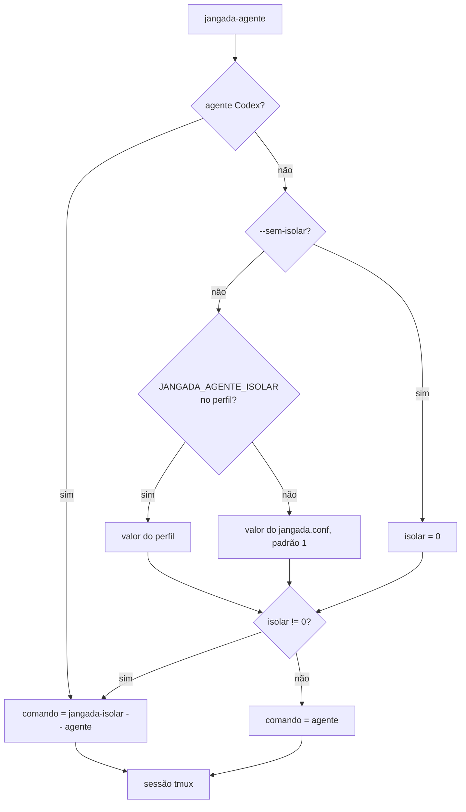
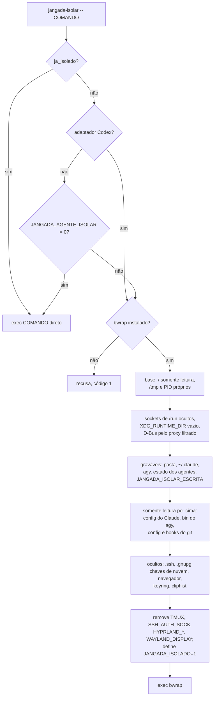
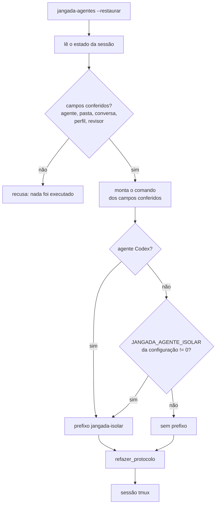

# Isolamento dos agentes

O agente (Claude, agy ou Codex) roda dentro do bubblewrap pelo `bin/jangada-isolar`.
Ele grava só na pasta da tarefa e no que o jangada libera; o resto da casa
fica somente leitura, e os segredos ficam ocultos. O objetivo é que nada do
que o agente fizer rode depois fora do isolamento: um hook do git, um
`settings.json` do Claude, um clone do AUR compilado com sudo.

O `jangada-isolar` e o `jangada-agentes` moram em `bin/` e a skill em
`agentes/claude/skills/jangada/`.

No Codex, dados de execução próprios da sessão são montados sobre a pasta
global do CLI, com configuração e login somente leitura. O servidor
compartilhado fica desligado. Veja [Codex](codex.md).

## Modelo de ameaça

O agente é tratado como possivelmente hostil. Ele lê páginas, issues, logs e
documentos, e um texto preparado ali (injeção de prompt) faz um agente
comum agir contra o usuário. Por isso a pergunta que decide cada caso é: o
que o agente grava pode rodar depois fora do isolamento? Se pode, o jangada
confere antes (o `restaurar` recompõe o comando, o `jangada-validar` lê as
regras da base, a atualização manual mostra os commits) ou recusa (o
`install.sh` não instala da cópia de trabalho). O isolamento não protege
contra falha do próprio bubblewrap nem do kernel.

A proteção é contra escrita, não contra leitura. O isolamento não garante que
o agente só conheça os dados do projeto:

- **Arquivos.** Desde 30/10/2026 a pasta pessoal começa vazia (veja Casa
  mínima): documentos, outros projetos, o histórico do shell e o
  `~/.Renviron` ficam fora de alcance. O resto do disco (`/etc`, `/mnt`,
  outros discos) segue legível, e o `.env` de outro projeto fora da pasta
  pessoal também.
- **Rede.** Não há namespace de rede próprio: o agente fala com a internet e
  com os serviços locais da máquina. O que ele lê, pode enviar.
- **Ambiente.** Desde 30/10/2026 o ambiente é mínimo (seção "Ambiente
  mínimo"): passa uma lista explícita, e sai todo nome que parece credencial.
  O valor de um segredo exportado com nome comum (`MEU_BANCO=senha`) não é
  inspecionado: ele sai porque não está na lista, e volta se alguém o puser
  em `JANGADA_ISOLAR_AMBIENTE_MANTER`.
- **Keyring.** O agy guarda o login no `org.freedesktop.secrets`. Desde
  30/10/2026 o proxy do D-Bus só libera itens de
  `JANGADA_ISOLAR_KEYRING_ITEM` (seção "Keyring por item"); sem ele, o
  keyring fica fechado e o agy sem login, com aviso.
  `JANGADA_ISOLAR_KEYRING=servico` volta a liberar o serviço inteiro, também
  com aviso. O keyring só é ligado quando o agy é um dos provedores
  concedidos.

## Limites conhecidos

As conversas e a memória em `~/.claude/projects` continuam graváveis pelo
agente, assim como o `settings.json` do agy em `~/.gemini/antigravity-cli`.
Esse arquivo guarda permissões e pastas confiáveis.

Um repositório aninhado criado no worktree e registrado no índice leva
sua própria configuração. Um `git status` executado fora do isolamento
poderia carregá-la. Por isso os scripts do jangada usam `jangada_git_seguro`
para consultar pastas de agentes.

## Decisão de isolar

Desde a correção P0 o isolamento é obrigatório para todos os agentes:
`--sem-isolar` e `JANGADA_AGENTE_ISOLAR=0` são ignorados com aviso. Os
fluxogramas e a precedência abaixo descrevem o comportamento anterior, nos
ramos que desligam o isolamento.



Para Claude e agy, `--sem-isolar` tem precedência; sem ela, vale o
`JANGADA_AGENTE_ISOLAR` do perfil e, depois, o da configuração.
O Codex sempre passa pelo isolamento, inclusive com essas opções desligadas.
O prefixo `jangada-isolar --` entra no comando da sessão. O campo `.isolar` do estado
da sessão é só para consulta.

## O que o jangada-isolar monta



A ordem importa: o bubblewrap aplica as montagens na sequência, e cada uma
vale por cima das anteriores. Por isso os graváveis vêm antes e o que precisa
ficar somente leitura dentro deles vem depois.

| Camada | O que entra | Por quê |
|---|---|---|
| Base | `/` somente leitura, `/dev`, `/proc`, `/tmp` próprio, `--unshare-pid`, `--die-with-parent` | um `rm` no `/tmp` não apaga os temporários do sistema; o agente não vê nem mata os processos da sessão, e o que ele deixou rodando morre com ele |
| `/run` | Docker, containerd, podman, tailscale, sshd local e D-Bus do sistema ocultos | esses sockets dão root ou mudam a máquina |
| `XDG_RUNTIME_DIR` | pasta vazia; o D-Bus da sessão volta pelo `xdg-dbus-proxy`, que só deixa falar com `org.freedesktop.Notifications` e, com o agy instalado, `org.freedesktop.secrets` | some o socket do Hyprland (`hyprctl dispatch` rodaria comando fora), do Wayland, do gpg-agent e do systemd do usuário; o agy lê o login do keyring e os hooks avisam pelo `notify-send` |
| Graváveis | pasta da tarefa, `~/.claude`, `~/.gemini/antigravity-cli`, `agentes/`, `validar.jsonl`, `eventos-agentes.jsonl` e `delegacoes.jsonl` do estado, e o que estiver em `JANGADA_ISOLAR_ESCRITA` | o resto do estado (barra, marcas das migrações) alimenta código que roda fora |
| Camada temporária | `~/.cache`; do Claude, `shell-snapshots`, `session-env` e `ide`; do agy, `bin` | o agente lê o conteúdo de fora, e o que grava some no fim (sobreposição do bwrap; sem suporte, o agente recebe uma pasta vazia em memória, e o `bin` do agy, somente leitura). O agy regrava o `agentapi` antes de cada comando, e o que ele regrava dentro não roda fora |
| Somente leitura | do Claude: `settings*.json`, `CLAUDE.md`, `commands`, `agents`, `skills`, `hooks`, `plugins`, scripts soltos; clones do AUR | tudo isso define comando ou instrução que valeria numa sessão aberta fora |
| Git | num worktree, o `.git` comum inteiro somente leitura, liberados `objects`, o gitdir do worktree e, das refs e dos `logs`, só a pasta do ramo da sessão (`refs/heads/agente`) e a das cópias do `reverter` (`refs/heads/backup`); direto no repositório, `config`, `hooks`, `commondir`, `worktrees` e `modules` somente leitura | `core.fsmonitor`, hooks e `commondir` rodariam fora no próximo `git status` |
| Ocultos | `.ssh`, `.gnupg`, `.password-store`, `.aws`, `.azure`, `.kube`, `.docker`, `.netrc`, `.git-credentials`, `gh`, `rclone`, `gcloud`, `op`, `sops`, Bitwarden, `.vault-token`, `.pgpass`, `.my.cnf`, `.pypirc`, perfis de navegador e do Thunderbird, keyrings, kwallet e o banco do `cliphist`; `JANGADA_ISOLAR_OCULTAR` troca a lista. A pasta `painel-chave` do estado, com o token do `jangada-painel`, a `revisoes`, com as revisões feitas fora do isolamento, e as `fotos` e `integracoes`, com as árvores da entrega que o `jangada-validar` e o `--integrar` extraem fora dele, ficam ocultas sempre; das fotos, só a escolhida em `JANGADA_ISOLAR_FOTO` volta ao revisor, somente leitura | segredos e o histórico da área de transferência; o painel responde a quem alcança a porta, e o agente isolado alcança; a aprovação que o `--integrar` aceita não pode ser escrita pelo agente revisado; as árvores da entrega trazem os links versionados dela e por isso ficam fora de `revisoes`, onde o `jangada-isolar` recusa link |
| Atendente da revisão | numa sessão de agente com cópia em `revisoes/SESSAO.json`, a pasta do soquete do atendente, somente leitura, em `/tmp/.jangada-atendente` (`JANGADA_VALIDAR_SOQUETE`) | o agente pede a revisão a um processo de fora, mas não troca nem apaga o soquete |

Para ver os argumentos sem abrir nada: `jangada-isolar --mostrar -- true`.
O `--mostrar` não abre o atendente.

## O atendente da revisão

Dentro do isolamento, `revisoes/` é uma pasta vazia, e o que o
`jangada-validar` gravasse ali sumiria no fim. O que ele grava no estado
(`agentes/`, `validar.jsonl`) o agente também edita. Por isso a revisão de
uma sessão de agente roda fora, pedida pelo soquete.

- **Quando abre:** no perfil `agente`, fora de outro isolamento, sem
  `JANGADA_ISOLAR_FOTO`, com `JANGADA_SESSAO` válida e
  `revisoes/SESSAO.json` presente e sem ser link. O revisor que o validar
  chama não abre outro atendente.
- **Onde fica:** um processo python fora do bwrap, com o soquete numa pasta
  0700 em `$XDG_RUNTIME_DIR/jangada-isolar/atendente-*`; sem
  `XDG_RUNTIME_DIR`, o atendente não abre. A pasta entra no bwrap somente
  leitura em `/tmp/.jangada-atendente`.
- **O que o agente pode pedir:** só a revisão do sha da cabeça, com a
  resposta ao parecer anterior. O `jangada-validar` de dentro lê o `HEAD` e
  manda o sha e, se houver, o texto de `--resposta`. Com `--forcar`,
  `--pular-local`, `--revisor`, `--modelo`, `--esforco`, `--base`,
  `--reverter-se-limite` ou `--atendido`, sai com 1 sem falar com o
  atendente. `--metricas` roda dentro, como antes.
- **O que o atendente aceita:** uma linha com o sha de 40 caracteres
  hexadecimais e, depois dela, a resposta: até 8 KiB de UTF-8 válido, sem
  caracteres de controle além da quebra de linha (tabulação também é
  recusada). O resto recebe `RECUSADO`. Um pedido por vez na sessão; outro,
  enquanto o primeiro roda, recebe `OCUPADO`. O sha e a resposta seguem como
  argumentos separados, sem shell, para
  `jangada-validar --atendido SHA --resposta TEXTO`; a resposta entra no
  pedido ao revisor como texto. Nenhum comando ou caminho do pedido é
  executado.
- **O que roda fora:** o `--atendido` lê a sessão, a base, o revisor, o
  modelo e o esforço de `revisoes/SESSAO.json` e o limite de rodadas do
  ambiente do atendente (`JANGADA_VALIDAR_RODADAS`). Ele recusa o sha que não
  for a cabeça do ramo da sessão, lida com o git blindado, a pasta que não
  estiver nessa cabeça e a pasta com alteração sem commit. Essas recusas vêm
  depois do `ACEITO`: o atendente só confere o formato, e quem conhece o ramo
  e a pasta é o `--atendido`, que sai com 1 e diz o motivo. A pasta com
  alteração sem commit é recusada porque a revisão vale para exatamente
  aquele sha: faça commit e peça de novo. Depois tira a foto
  em `fotos/`, roda a verificação local e o revisor sob a trava de
  `revisoes/travas/`, e grava parecer, contexto, marca e linha de
  `validar.jsonl` em `revisoes/`. O sha já revisado contra a mesma base
  devolve o parecer gravado, sem chamar o revisor e sem gastar rodada.
- **Erros do revisor:** a rodada em que o revisor falha ou vence o prazo
  (`JANGADA_VALIDAR_PRAZO`) não grava parecer e não conta no limite. O
  `--atendido` conta os erros seguidos em `revisoes/validacao-SESSAO.erros`;
  no terceiro, e nos pedidos seguintes, sai com 1 e "o revisor falhou 3
  vezes seguidas; peça ao coordenador". A rodada com parecer, inclusive a
  reprovada na verificação local, apaga a contagem. O coordenador libera
  apagando o arquivo ou rodando o validar fora, e o `jangada-agente-fim`
  o apaga no encerramento.
- **A resposta:** o texto do parecer e o código de saída voltam pelo soquete
  como dado; o validar de dentro só os imprime.
- **Sem atendente** (isolar antigo, sessão sem cópia protegida, sem
  `XDG_RUNTIME_DIR`, soquete ausente ou sem resposta em 10 s): o validar de
  dentro sai com 1 e a mensagem "revisão fora do isolamento indisponível;
  peça ao coordenador", sem gravar nada. Não há variável que leve a revisão
  para dentro: o agente define as variáveis de dentro.
- **Fim:** o atendente sai quando o `jangada-isolar` acaba, mesmo morto por
  KILL (confere o pai a cada segundo), e mata a revisão em curso.

## A marca de isolamento

`ja_isolado` em `bin/jangada-isolar` só aceita a marca quando as duas coisas
valem: `JANGADA_ISOLADO` no ambiente e o ponto de montagem
`/tmp/.jangada-isolado` em `/proc/self/mountinfo`. Qualquer processo cria um
arquivo no `/tmp`, mas só quem monta cria um ponto de montagem; por isso a
variável herdada não basta para pular o isolamento.

## Perfis, rede e credenciais dos provedores

O `jangada-isolar` tem três perfis, escolhidos por `JANGADA_ISOLAR_PERFIL`:

| Perfil | Rede | Login e chaves dos provedores | Quem usa |
|---|---|---|---|
| `agente` (padrão) | a da máquina | só os dos provedores concedidos | `jangada-agente`, `jangada-delegar`, revisores |
| `verificacao` | nenhuma (`--unshare-net`) | ocultos | `lintr` e `.jangada/validar.sh` no `jangada-validar` |
| `verificacao-rede` | a da máquina | ocultos | `.jangada/validar.sh` com `JANGADA_VALIDAR_REDE=1` |

Fora do perfil `agente` somem `~/.claude`, `~/.claude.json`, `~/.codex`,
`~/.gemini` e as variáveis `ANTHROPIC_*`, `OPENAI_*`, `GEMINI_*`, `GOOGLE_*`,
`CLAUDE_*`, `CODEX_*`, `AGY_*` e `ANTIGRAVITY_*`, e o D-Bus não é ligado.
Perfil desconhecido é recusado. Dentro de uma sessão já isolada, o perfil
`agente` roda direto. Os perfis de verificação criam outro isolamento para
retirar as credenciais e aplicar sua política de rede, mesmo com
`JANGADA_AGENTE_ISOLAR=0`.

### Provedores concedidos

No perfil `agente`, desde 30/10/2026, o agente só recebe o login dos
provedores concedidos à sessão. Os outros somem como no perfil de
verificação: pastas (`~/.claude`, `~/.claude.json`, `~/.config/claude`,
`~/.codex`, `~/.gemini`) e variáveis da família. Concedidos são:

- o provedor principal: o de `--provedor` (`claude`, `codex`, `agy` ou
  `nenhum`) ou, sem a opção, o nome do comando (`claude`, `agy`, `codex` ou
  `jangada-codex`). Outro comando (um `bash`, o `Rscript`) não recebe login;
- o destino da delegação, com `--delegar DESTINO`, resolvido pela mesma
  regra do `jangada_delegacao` (o Claude delega ao agy ou ao próprio Claude;
  o Codex, ao agy). O `jangada-agente` e o `jangada-agentes` passam o
  `--delegar` da sessão;
- o Codex, quando `JANGADA_CODEX_ECONOMICO_MODELO` ou
  `JANGADA_CODEX_PRINCIPAL_MODELO` estão definidos;
- os de `JANGADA_ISOLAR_PROVEDORES`, separados por `:`.

Nome desconhecido em qualquer dessas fontes é recusado. A lista vai ao
agente em `JANGADA_ISOLAR_CONCEDIDOS`; dentro da sessão, o `jangada-isolar`
recusa abrir o comando de um provedor que não está nela, em vez de abri-lo
sem login. O `jangada-delegar` abre o agy com `--provedor agy`.

Com o agy concedido e o catálogo de contas, só a pasta da conta escolhida é
montada; as outras contas do catálogo ficam vazias.

Não há política de rede nem intermediário de credenciais: o agente fala com
qualquer destino. Um agente desviado por injeção de prompt consegue enviar
para fora o login que recebeu. Um intermediário (processo fora do
isolamento que guarda as chaves e assina as chamadas) fecharia isso, mas
depende de cada cliente aceitar um endereço de API próprio e fica fora do
que o jangada faz hoje. Reduz o dano: usar login de assinatura em vez de
chave de API com cobrança por uso.

## Refs do git

Num worktree, o agente grava só na pasta de refs do próprio ramo. Como todas
as sessões usam `refs/heads/agente/`, uma sessão consegue mover o ramo de
outra. O git cria o `.lock` ao lado da ref, então liberar um arquivo só não
funciona. A defesa fica na integração: o `--integrar` só aceita o commit e a
árvore que a revisão de fora aprovou, e um ramo movido volta a ser revisado.
Repositório com refs em reftable guarda tudo numa pasta só; ali o
`jangada-isolar` recusa abrir o worktree e mostra o comando de conversão.

## Casa mínima

Desde 30/10/2026 é o padrão (antes, só com `JANGADA_ISOLAR_CASA=minima`): a
pasta pessoal vira uma pasta vazia em memória antes das outras montagens. Por
cima dela voltam, somente leitura:

- as pastas do `PATH` dentro da pasta pessoal, `~/.local/bin`, `~/.local/lib`,
  `~/.local/share/claude`, `~/.local/share/mise` e `~/.config/mise`;
- a cópia instalada, a configuração e o estado do jangada;
- `~/.gitconfig`, `~/.config/git` e `~/R`;
- `~/.claude.json`, `~/.gemini` e `~/.codex`, cada um só se o provedor for
  concedido;
- o que estiver em `JANGADA_ISOLAR_CASA_LER`, separado por `:`.

As regras de graváveis, somente leitura e ocultos valem como antes, por cima.
Documentos, outros projetos, o histórico do shell e o `~/.Renviron` deixam de
existir para o agente. O que ele grava solto na pasta pessoal fica em memória
e some no fim.

Os arquivos de início do shell (`.zshrc`, `.bashrc`, `.profile` e os demais)
ficam de fora desde 05/10/2026: é neles que se exporta token. Quem precisa
deles no agente acrescenta em `JANGADA_ISOLAR_CASA_LER`.

A lista cobre o que o jangada conhece: `~/.cargo`, `~/.nvm`, o
`~/.Rprofile` ou dados que o projeto alcança por link (`.jangada/links`)
precisam entrar em `JANGADA_ISOLAR_CASA_LER`. O que fica fora da pasta
pessoal (`/etc`, `/mnt`, outros discos) segue legível. A casa mínima vale
também nos perfis de verificação; o perfil `implementacao` tem montagem
própria.

`JANGADA_ISOLAR_CASA=inteira` volta à casa inteira legível, menos os
ocultos, e avisa a cada abertura. Os logins de provedor não concedido
continuam ocultos nesse modo.

## Keyring por item

`JANGADA_ISOLAR_KEYRING_ITEM` recebe os atributos do item do agy no keyring,
em pares `atributo=valor` separados por espaço. Na abertura, fora do
isolamento, o `jangada-isolar` procura os itens com esses atributos e o proxy
passa a liberar só eles. O resto do serviço fica assim:

- leitura de outro item (`GetSecret`, propriedades) e leitura em lote
  (`Service.GetSecrets`): negadas;
- busca por atributos na coleção: liberada, devolve caminhos e não segredos;
- `CreateItem` na coleção: liberado, porque o agy regrava o token por ele.
  Com isso o agente ainda cria item e sobrescreve um item cujos atributos
  conheça, sem ler o valor antigo;
- destrancar a coleção e responder ao pedido de senha: liberados.

Um item criado durante a sessão só fica legível na abertura seguinte. Valor
fora do formato fecha a leitura do keyring e avisa no terminal.

### Implementador chamado de dentro do isolamento

O proxy do implementador não pode ser encadeado atrás do proxy do autor: o
`xdg-dbus-proxy` interno envia chamadas com número de série 0xFFFF0000, que o
proxy externo trata como inválido e por isso derruba a conexão. O agy do
implementador ficaria sem o item do keyring e sairia sem login. Além disso, o
proxy do autor nega `Service.SearchItems`, e a busca do item ficaria vazia.

Por isso, na abertura da sessão do autor (perfil `agente`, com
`JANGADA_ISOLAR_KEYRING_ITEM`), o `jangada-isolar` de fora sobe um segundo
proxy, com o filtro do implementador, e o liga em
`$XDG_RUNTIME_DIR/bus-implementacao`. O filtro do implementador é subconjunto
do filtro do autor: só `GetSecret` e propriedades do item, busca na coleção e
nada de `CreateItem`. A chamada aninhada não sobe proxy nem busca itens: só
monta esse soquete como `bus` do implementador. O caminho é fixo e precisa ser
soquete, não link, e ponto de montagem em `/proc/self/mountinfo` (com os
escapes `\040` e afins do caminho tratados). Um soquete
que o autor criou na própria pasta em memória, ou em outro `XDG_RUNTIME_DIR`,
e que repasse ao `bus` dele (com `CreateItem`) não é montagem e é recusado
com o código 69.

Risco residual aceito pelo dono em 25/10/2026: um autor que monte o próprio
`bus` nesse caminho, num namespace de usuário dele, entrega ao implementador
o filtro do autor (`*@item` e `CreateItem`). Dentro da sessão o autor controla
tudo o que o isolar aninhado enxerga, então não existe referência de origem
que ele não possa trocar; identificar o cliente do soquete também não adianta,
pois o autor roda com o mesmo uid. O implementador não passa do que o autor já
alcança. Fechar o caso exige tirar `CreateItem` e `*@item` do filtro do autor,
para que o filtro dele seja igual ao do implementador e forjar não acrescente
nada. É tarefa à parte: o agy do autor deixa de regravar o token dentro da
sessão, e a renovação do login passa a ser feita fora do isolamento.

Sem o soquete, a chamada aninhada sai com código 69 e a linha
`jangada-isolar: sem login do agy no keyring: ...`. O `jangada-delegar` grava
`motivo_codigo` `sem_login_agy` e o `implementacao.py` mostra "o agy do
implementador ficou sem login no keyring". Fora do isolamento, o perfil
`implementacao` com busca vazia também sai com 69.

`sem_login_agy` vale só quando o isolador detecta a falta: sessão sem o
soquete do implementador, item ausente no keyring ou código 69. Com o item
presente e a credencial do agy vencida ou inválida, o agy sai com código 1 e
o registro diz `erro_execucao`, com o código de saída no `motivo`. A
renovação do login é feita fora do isolamento. Não há sinal confiável da
falha de autenticação sem o agy real, pois a mensagem de login também aparece
nas chamadas boas. O dono decidiu esse escopo em 25/10/2026.

Os atributos do item do agy não estão documentados. Para listar os de todos
os itens, sem os segredos, num terminal fora do isolamento:

```bash
for i in $(gdbus call --session --dest org.freedesktop.secrets \
    --object-path /org/freedesktop/secrets \
    --method org.freedesktop.Secret.Service.SearchItems '@a{ss} {}' \
    | grep -oE '/org/freedesktop/secrets/collection/[A-Za-z0-9_]+/[A-Za-z0-9_]+'); do
  gdbus call --session --dest org.freedesktop.secrets --object-path "$i" \
    --method org.freedesktop.DBus.Properties.Get org.freedesktop.Secret.Item Attributes
done
```

## Ambiente mínimo

Desde 30/10/2026 é o padrão em todos os perfis (antes, só com
`JANGADA_ISOLAR_AMBIENTE=minimo`). Cada variável exportada passa por esta
ordem, e a primeira regra que vale decide:

1. família de um provedor (`CLAUDE_*` e `ANTHROPIC_*`; `CODEX_*` e
   `OPENAI_*`; `GEMINI_*`, `GOOGLE_*`, `AGY_*` e `ANTIGRAVITY_*`): passa só
   se o provedor for concedido;
2. nome em `JANGADA_ISOLAR_AMBIENTE_MANTER` (separado por `:`): passa;
3. nome que parece credencial (contém `TOKEN`, `SECRET`, `PASSWORD`,
   `PASSWD`, `PASSPHRASE`, `CREDENTIAL`, `API_KEY`, `APIKEY`,
   `PRIVATE_KEY`, `ACCESS_KEY` ou `SENHA`, tem `AUTH` ou `AUTHORIZATION`
   como parte separada por `_`, ou termina em `_PAT`): sai,
   inclusive nas famílias da lista (`MISE_GITHUB_TOKEN`, `NODE_AUTH_TOKEN`);
4. lista base: `HOME`, `USER`, `LOGNAME`, `SHELL`, `PATH`, `PWD`, `TERM`,
   `COLORTERM`, `LANG`, `LANGUAGE`, `TZ`, `TMPDIR`, `EDITOR`, `VISUAL`,
   `PAGER`, `NO_COLOR`, `DBUS_SESSION_BUS_ADDRESS`, `SSL_CERT_FILE`,
   `SSL_CERT_DIR`, os de proxy, `R_LIBS`, `R_LIBS_USER`, `R_LIBS_SITE`,
   `R_PROFILE_USER`, `R_ENVIRON_USER`, `R_LINTR_LINTER_FILE`, a identidade
   do git (`GIT_AUTHOR_NAME`, `GIT_AUTHOR_EMAIL`, `GIT_COMMITTER_NAME`,
   `GIT_COMMITTER_EMAIL`), `GIT_CONFIG_GLOBAL`, `GIT_CONFIG_NOSYSTEM` e as famílias
   `LC_*`, `XDG_*`, `JANGADA_*`, `MISE_*`, `__MISE_*` e `NODE_*`: passa;
5. o resto sai.

A lista fixa (`GH_TOKEN`, `GITHUB_TOKEN`, `AWS_SECRET_ACCESS_KEY`,
`VAULT_TOKEN`, `PGPASSWORD` e as demais no `jangada-isolar`) sai sempre, mesmo
listada em `JANGADA_ISOLAR_AMBIENTE_MANTER`. As variáveis saem por nome
(`--unsetenv`), e nenhum valor vai à linha de comando do `bwrap` nem à saída
do `--mostrar`.

`JANGADA_ISOLAR_AMBIENTE=herdado` volta a herdar o ambiente, com aviso a cada
abertura; as regras 1 a 3 e a lista fixa continuam valendo.

O shell que o agente abre dentro do isolamento lê de novo os arquivos de
início: o que eles exportam volta, a menos que a casa mínima os deixe de fora
(o padrão).

## Modos e transição

Os padrões de 30/10/2026 mudam o que a sessão enxerga. Cada um tem uma
variável no `jangada.conf` para voltar ao modo antigo, sempre com aviso no
terminal a cada abertura. Valor fora da lista é recusado com código 1, para
que um erro de digitação não desligue a proteção calado.

| Variável | Padrão | Valores | Modo antigo |
|---|---|---|---|
| `JANGADA_ISOLAR_CASA` | `minima` | `minima`, `inteira` | `inteira` |
| `JANGADA_ISOLAR_AMBIENTE` | `minimo` | `minimo`, `herdado` | `herdado` |
| `JANGADA_ISOLAR_KEYRING` | `itens` | `itens`, `servico` | `servico` (sem `JANGADA_ISOLAR_KEYRING_ITEM`) |
| `JANGADA_ISOLAR_PROVEDORES` | vazio | `claude`, `codex`, `agy` separados por `:` | `claude:codex:agy` |

Os ajustes finos, sem voltar ao modo antigo, são `JANGADA_ISOLAR_CASA_LER`
(caminhos) e `JANGADA_ISOLAR_AMBIENTE_MANTER` (nomes de variável). Veja
também [atualização e migrações](atualizacao-e-migracoes.md).

## Limitações desta proteção

- Não é certificação de segurança geral nem homologação dos provedores
  reais: os testes usam provedores e credenciais fictícios.
- O agente lê o login dos provedores concedidos e pode enviá-lo pela rede.
- `JANGADA_ISOLAR_KEYRING_ITEM` vale para todas as contas do agy: o item
  liberado não muda com a conta escolhida no catálogo.
- O filtro de variáveis olha o nome, não o valor.
- Um SIGKILL no `jangada-isolar` não deixa o próprio processo limpar nada.
  O `bwrap` com `--die-with-parent` encerra o agente, e o proxy do D-Bus sai
  quando o cano que o prende fecha. O arquivo do soquete
  (`$XDG_RUNTIME_DIR/jangada-isolar/bus-PID`) pode sobrar sem ninguém
  escutando; não guarda segredo e só é apagado quando outra abertura recebe
  o mesmo PID. A cópia do login do Codex tem recuperação própria, que só
  apaga resíduo do mesmo usuário, com mais de 60 segundos e sem trava viva
  (veja [Codex](codex.md)).

## Falhas

- Sem `bwrap`: o `jangada-isolar` recusa com código 1 e nenhum agente abre;
  instale o pacote `bubblewrap`.
- Sem proxy do D-Bus (programa ausente ou sem resposta em 5 segundos): o
  agente abre sem D-Bus, e o agy não acha o login.
- Apagar ramo ou tag e o `git gc` falham dentro de um worktree, porque
  regravam o `packed-refs`, que fica na raiz somente leitura.
- Dentro de um worktree, o agente não move `main` nem outro ramo fora de
  `agente/` e `backup/`, e não cria tag, stash nem ref de remoto: `git stash`,
  `git tag`, `git fetch` e `git branch outro-nome` falham. Os ramos das outras
  sessões ficam na mesma pasta `agente/` e seguem ao alcance. Num repositório
  com `reftable`, todas as refs ficam numa pasta só e seguem graváveis.

## Restauração



`restaurar` em `bin/jangada-agentes` nunca executa o `.comando` nem lê o
`.isolar` do estado: o arquivo fica numa pasta que o agente grava, e um
agente poderia trocar o comando ou desligar o isolamento da próxima abertura.
O perfil também não desliga o isolamento na restauração. O Codex sempre
recebe o prefixo de isolamento, mesmo com a configuração global desligada.
O protocolo é refeito numa gravação por `mv -fT`, que não segue um link plantado.

## Testes

O processo externo também observa as gravações do arquivo de estado da
sessão com `inotifywait`. Apenas o nome de sessão conferido é observado;
o conteúdo do arquivo não é executado. Cada mudança avisa a Waybar com
o sinal 10. Isso permite atualização imediata, pois o hook isolado não
enxerga o processo da barra no namespace de PID do host. O observador
e o processo de `inotifywait` são encerrados junto com o isolamento.

| Arquivo | O que cobre |
|---|---|
| `testes/isolar.sh` | argumentos do bwrap (gravável, somente leitura, oculto, `/tmp`, marca), repositório direto, `JANGADA_AGENTE_ISOLAR=0`, variável sem marca não dispensa, recusa sem bwrap e um isolamento de verdade: gravação, commit, chave oculta, D-Bus restrito e PID próprio |
| `testes/restaurar.sh` | comando gravado e `.isolar: false` ignorados, `JANGADA_AGENTE_ISOLAR=0` abre fora, campos inválidos recusados, perfil não desliga o isolamento, protocolo refeito sem seguir link, delegação passada ao isolamento |
| `testes/isolar-provedores.py` | isolamento real com credenciais fictícias: cada provedor lê só o próprio login, comando comum não recebe nenhum, delegação concede só o destino, conta do agy só a escolhida, transição com aviso, execuções simultâneas separadas, sessão aninhada recusa provedor não concedido, modos inválidos recusados |

Dentro de uma sessão do agente, o `testes/isolar.sh` passa, mas pula o caso
do D-Bus (o endereço do barramento não entra no teste) e a leitura da casa
mínima (`/var/tmp` é somente leitura). A conferência completa é num terminal
comum.

Veja também o [ciclo da tarefa](ciclo-da-tarefa.md) e a seção de isolamento
da skill em `agentes/claude/skills/jangada/agentes.md`.

## Isolamento da implementação delimitada

O perfil `implementacao` sempre cria outro isolamento. Ele expõe fontes
copiadas e arquivos exatos, sem liberar worktree, Git ou estado persistente.
O estado do CLI é temporário e o keyring selecionado é somente leitura.
Veja o [contrato do piloto](coordenacao-central/10-executor-agy.md).

## Ajustes pessoais das montagens

`JANGADA_ISOLAR_ESCRITA` acrescenta pastas graváveis separadas por `:`, como
`~/dados:~/R`. `JANGADA_ISOLAR_OCULTAR` substitui a lista de ocultos;
definida vazia, remove os ocultos opcionais. Para acrescentar caminhos sem
perder a lista padrão, use `JANGADA_ISOLAR_OCULTAR_EXTRA`.
As pastas protegidas do controlador continuam ocultas independentemente dessas opções.
